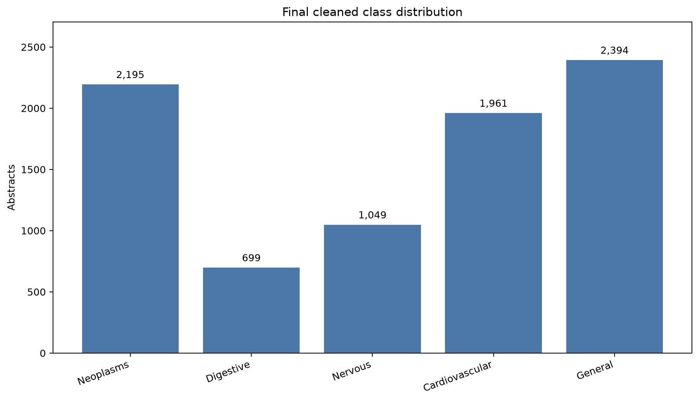
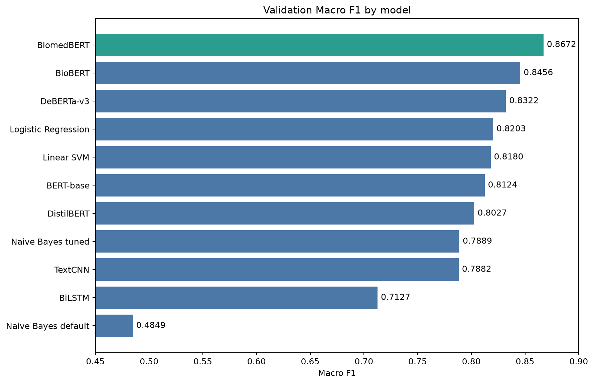
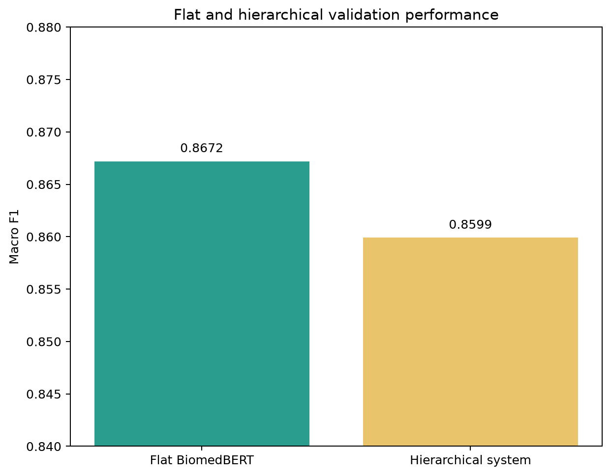
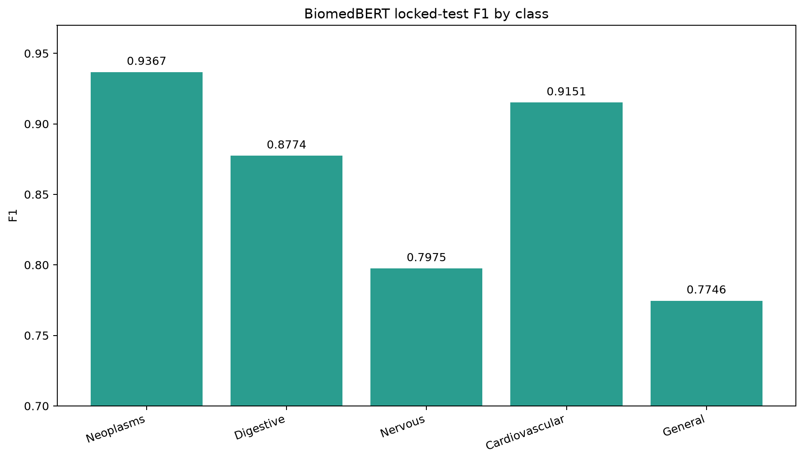

# Team Ultron: Medical Abstract Disease Classification

COE025 Natural Language Processing, Project 1, Istinye University, Fall 2026-27.

Public repository: <https://github.com/RanimAlyasein/team-ultron-medical-abstract-classification>

## Team Ultron

Team Ultron developed and evaluated a five-class medical abstract classifier. The repository contains the raw and cleaned data, reproducible dataset pipeline, available training code, canonical experiment records, figures, reports, final presentation, and individual contribution statements.

## Project overview

The project studies whether classical, neural, general-purpose transformer, and biomedical transformer models can assign one disease category to a medical research abstract. The work emphasizes dataset integrity, validation-only model selection, and a single locked-test evaluation of the selected model.

BiomedBERT achieved the best validation Macro F1 and remained the final model.

| Final result | Value |
| --- | ---: |
| BiomedBERT validation Macro F1 | **0.8672** |
| BiomedBERT locked-test Macro F1 | **0.8603** |
| Validation-to-test gap | **0.0069** |
| Hierarchical validation Macro F1 | **0.8599** |
| Expected Calibration Error | **0.1041** |
| T4 inference throughput | **35.62 abstracts/s** |

## Problem definition

Given one medical research abstract, predict exactly one of five classes:

1. Neoplasms
2. Digestive system diseases
3. Nervous system diseases
4. Cardiovascular diseases
5. General pathological conditions

This is a single-label multiclass text-classification problem.

## Dataset source and citation

The project uses the [Medical Abstracts Text Classification Corpus](https://github.com/sebischair/Medical-Abstracts-TC-Corpus) by Schopf, Braun, and Matthes (2023), DOI [10.1145/3582768.3582795](https://doi.org/10.1145/3582768.3582795). The raw files are retained under [`data/raw/`](data/raw/).

The original corpus contains 14,438 rows:

- Training file: 11,550 rows
- Test file: 2,888 rows
- Five disease labels

## Dataset audit

The audit compares exact abstract text without case conversion, whitespace normalization, stemming, or lemmatization.

| Audit finding | Count |
| --- | ---: |
| Original rows | 14,438 |
| Unique exact abstract texts | 11,227 |
| Conflicting-label abstract groups | 2,929 |
| Rows in conflicting groups | 6,140 |
| Unique abstracts shared by the original train and test files | 988 |
| Missing labels or abstracts | 0 |

The 988 cross-file abstracts made the original test split unsuitable for an independent evaluation. Full evidence is available in [`reports/dataset_audit_report.txt`](reports/dataset_audit_report.txt), [`reports/conflicting_abstracts.csv`](reports/conflicting_abstracts.csv), and [`reports/original_train_test_overlap.csv`](reports/original_train_test_overlap.csv).

## Cleaning methodology

The cleaning pipeline:

1. Combines the original train and test rows in memory.
2. Groups rows by exact `medical_abstract` text.
3. Removes every text group associated with more than one label.
4. Keeps one copy of each remaining unique, single-label abstract.
5. Assigns a stable `abstract_id` from the first 16 hexadecimal characters of the exact text's SHA-256 hash.
6. Preserves the original text for model-specific tokenization.

The pipeline does not assign majority labels to conflicting examples. That choice avoids inventing targets unsupported by the source data. See [`DATASET_PREPARATION.md`](DATASET_PREPARATION.md) for the full rationale.

## Final data splits

The cleaned dataset contains 8,298 unique abstracts. A deterministic stratified split with seed 42 produced:

| Split | Rows | Share | Use |
| --- | ---: | ---: | --- |
| Train | 5,808 | 69.99% | Fit model parameters |
| Validation | 1,245 | 15.00% | Tune settings and select models |
| Test | 1,245 | 15.00% | Final evaluation only |

There is zero abstract-ID overlap and zero exact-text overlap across every pair of final splits. The test set remained locked until the final model had been selected using validation Macro F1.

## Class distribution

| Class | Cleaned abstracts | Share |
| --- | ---: | ---: |
| Neoplasms | 2,195 | 26.45% |
| Digestive system diseases | 699 | 8.42% |
| Nervous system diseases | 1,049 | 12.64% |
| Cardiovascular diseases | 1,961 | 23.63% |
| General pathological conditions | 2,394 | 28.85% |
| **Total** | **8,298** | **100.00%** |



## Evaluation metrics

The primary metric is **Macro F1**. Supporting metrics are accuracy, Macro Precision, Macro Recall, Weighted F1, per-class F1, and confusion matrices when the underlying predictions were retained.

### Why Macro F1

The class distribution is imbalanced, especially for digestive system diseases. Macro F1 gives each class equal weight, so a model cannot hide weak minority-class performance behind strong results on larger classes.

The default Multinomial Naive Bayes model illustrates this issue:

| Metric | Value |
| --- | ---: |
| Accuracy | 0.6755 |
| Macro F1 | 0.4849 |

Accuracy alone would make this model appear substantially stronger than its balanced class performance indicates.

## Models and rationale

| Family | Models | Reason for inclusion |
| --- | --- | --- |
| Classical | Multinomial Naive Bayes, Logistic Regression, Linear SVM | Establish sparse TF-IDF baselines and test whether linear decision boundaries remain competitive |
| Neural | TextCNN, BiLSTM | Compare local n-gram feature learning with bidirectional sequential modeling |
| General transformers | BERT-base, DistilBERT | Measure contextual pretraining and the speed-size tradeoff of a compressed transformer |
| Domain-specific and newer transformers | BioBERT, BiomedBERT, DeBERTa-v3 | Test biomedical pretraining against a newer general architecture |

BERT, BioBERT, and BiomedBERT use closely related BERT-family architectures but different pretrained checkpoints and corpora. DeBERTa-v3 is a different architecture with disentangled attention. The comparison therefore separates architecture changes from domain-specific pretraining.

## Experiments and technical decisions

| Experiment or decision | Retained evidence |
| --- | --- |
| Word unigram TF-IDF | Implemented in the notebook and `src/run_classical.py` |
| Word unigram + bigram TF-IDF | Implemented and compared on validation |
| Word + character TF-IDF | Implemented with word features and character 3-5 grams |
| Naive Bayes tuning | Default and tuned results are reported separately |
| Logistic Regression and SVM tuning | Validation-only searches over regularization and class weighting |
| Learning curve | No retained code or machine-readable result is present, so no value is reported |
| TextCNN filter sizes | Compared `(3, 4, 5)` with `(2, 3, 4, 5)` |
| BiLSTM packed-sequence correction | Sequence lengths and packed inputs prevent padding from driving the recurrent state |
| Class-weighted loss | Tested for the neural models to address class imbalance |
| Tokenizer length analysis | Supported `max_length = 512`; the retained presentation reports 1.36% of BiomedBERT inputs above 512 tokens |
| DeBERTa-v3 memory adjustment | Used batch size 2 with gradient accumulation 4 on a Colab T4 |
| Biomedical pretraining comparison | BioBERT and BiomedBERT were compared with general BERT |
| Hierarchical classification | Tested Specific versus General routing followed by four-class classification |
| Calibration and confidence thresholds | ECE and coverage at threshold 0.90 were retained |
| Efficiency | Parameter count and T4 inference timing were retained |
| Locked test | BiomedBERT was evaluated after validation-only selection |

See [`BENCHMARK.md`](BENCHMARK.md) for hyperparameters, model-level observations, and the deeper evaluation record.

## Validation benchmark

| Rank | Model | Family | Accuracy | Macro F1 |
| ---: | --- | --- | ---: | ---: |
| 1 | **BiomedBERT** | Biomedical transformer | 0.8683 | **0.8672** |
| 2 | BioBERT | Biomedical transformer | 0.8490 | 0.8456 |
| 3 | DeBERTa-v3 | Newer transformer | 0.8313 | 0.8322 |
| 4 | Logistic Regression | Classical | 0.8217 | 0.8203 |
| 5 | Linear SVM | Classical | 0.8241 | 0.8180 |
| 6 | BERT-base | General transformer | Not retained | 0.8124 |
| 7 | DistilBERT | General transformer | 0.8048 | 0.8027 |
| 8 | Naive Bayes, tuned | Classical | 0.7920 | 0.7889 |
| 9 | TextCNN | Neural | Not retained | 0.7882 |
| 10 | BiLSTM | Neural | 0.7333 | 0.7127 |
| 11 | Naive Bayes, default | Classical | 0.6755 | 0.4849 |



The canonical table is [`results/validation_benchmark.csv`](results/validation_benchmark.csv). Blank values remain blank rather than being estimated from older notebook runs.

## Error analysis

BiomedBERT's weakest validation class was General pathological conditions, with F1 0.7859. The retained validation confusion matrix in the notebook shows that many errors cross the boundary between this broad class and one of the four specific disease classes. The final locked-test per-class results show the same class as the hardest category, with F1 0.7746.

The repository does not contain the locked-test confusion counts or the saved checkpoint needed to recreate them. It therefore does not include a misleading `final_confusion_matrix.png` derived from validation data.

## Hierarchical experiment

The two-stage system first predicts Specific versus General, then assigns one of four specific disease classes when routed to the second stage.

| System | Validation Macro F1 | General-class F1 |
| --- | ---: | ---: |
| Stage 1: Specific vs General | 0.8572 | Not applicable |
| Stage 2: four specific classes | 0.9478 | Not applicable |
| Combined hierarchical system | 0.8599 | 0.7978 |
| Flat BiomedBERT | **0.8672** | 0.7859 |

The hierarchy slightly improved the General class, but routing errors reduced overall Macro F1. The flat BiomedBERT model remained selected.



## Calibration and confidence analysis

| Validation measure | Value |
| --- | ---: |
| Accuracy | 0.8683 |
| Mean confidence | 0.9706 |
| Expected Calibration Error | 0.1041 |
| Coverage at confidence >= 0.90 | 92.61% |
| Accepted samples | 1,153 / 1,245 |
| Accuracy on accepted predictions | 89.68% |

The model is overconfident. Its raw confidence values should not be interpreted as perfectly calibrated probabilities. The aggregate record is in [`results/calibration_results.csv`](results/calibration_results.csv), and [`src/calibration_analysis.py`](src/calibration_analysis.py) can recompute bins from prediction-level exports. Those raw probabilities were not retained, so the repository does not fabricate a reliability diagram.

## Efficiency results

| Measure | Value |
| --- | ---: |
| Parameters | 109,486,085 |
| Validation samples | 1,245 |
| Total inference time | 34.95 s |
| Time per abstract | 28.07 ms |
| Throughput | 35.62 abstracts/s |
| Hardware | Google Colab T4 GPU |

This is practical inference speed on a T4 GPU. The measurement does not establish a real-time service guarantee.

## Final model selection

BiomedBERT was selected because it achieved the highest validation Macro F1, 0.8672. Domain-specific biomedical pretraining produced a larger gain than changing from BERT to the newer general-purpose DeBERTa-v3 architecture in this experiment.

## Locked test-set results

The selected BiomedBERT checkpoint was evaluated once on the locked test set.

| Metric | Value |
| --- | ---: |
| Accuracy | 0.8635 |
| Macro Precision | 0.8563 |
| Macro Recall | 0.8651 |
| Macro F1 | **0.8603** |
| Weighted F1 | 0.8623 |

| Class | F1 |
| --- | ---: |
| Neoplasms | 0.9367 |
| Digestive system diseases | 0.8774 |
| Nervous system diseases | 0.7975 |
| Cardiovascular diseases | 0.9151 |
| General pathological conditions | 0.7746 |



Validation Macro F1 decreased from 0.8672 to 0.8603, a gap of 0.0069. This is a small validation-to-test gap indicating stable generalization.

## Limitations and unavailable artifacts

- The benchmark uses one deterministic split rather than repeated seeds or cross-validation.
- Exact conflicting-label groups were removed, but some remaining abstracts may still be semantically compatible with more than one class.
- The final model is overconfident and needs additional calibration before confidence-based automation.
- Biomedical pretraining may have exposed the model to some abstract text without labels.
- The repository does not contain standalone DistilBERT or final BiomedBERT notebooks. Their available code is retained in the consolidated benchmark notebook.
- No verified learning-curve values, prediction-level calibration bins, or locked-test confusion counts were retained. Corresponding files and figures are not fabricated.

## Reproduction instructions

Python 3.10 or newer is recommended.

```bash
python -m venv .venv
# Windows: .venv\Scripts\activate
# macOS/Linux: source .venv/bin/activate
pip install -r requirements.txt
```

Recreate and verify the data artifacts:

```bash
python src/01_dataset_audit.py
python src/02_clean_dataset.py
python src/03_create_splits.py
python src/verify_artifacts.py
```

Reproduce the classical comparison and repository figures:

```bash
python src/run_classical.py --data-dir data/processed --output results/classical_reproduction.csv
python src/make_figures.py
```

Transformer and neural training code is retained in [`notebooks/04_baseline_benchmark.ipynb`](notebooks/04_baseline_benchmark.ipynb). The final shared Colab document is:

<https://colab.research.google.com/drive/16WUP3B2rwgcXii_abqoziN7KphqATjCP?usp=sharing>

Use a GPU runtime, provide the files from `data/processed/`, and execute cells in order. GPU results can vary slightly even with fixed seeds; the committed result tables remain the canonical project record.

## Repository structure

```text
team-ultron-medical-abstract-classification/
├── README.md
├── BENCHMARK.md
├── DATASET_PREPARATION.md
├── LICENSE
├── requirements.txt
├── data/
│   ├── raw/                  original corpus and upstream license
│   └── processed/            cleaned master and frozen splits
├── src/                      audit, cleaning, splitting, baselines, calibration, figures, verification
├── notebooks/                consolidated training and evaluation notebook
├── results/                  canonical machine-readable experiment records
├── figures/                  reproducible figures backed by retained data
├── reports/                  audit, cleaning, split, and model reports
├── presentation/             editable presentation and final PDF
└── contributions/            final agreed contribution records
```

## Team contributions

| Member | Final responsibilities |
| --- | --- |
| Saleh Almasaadi | Dataset cleaning; final train / validation / test splits; support for the final presentation |
| Tasnim Alibraheem | Model research; evaluation-metric selection |
| Ranim Alyasein | Model training and comparison; BiomedBERT fine-tuning; benchmark construction; experiment and error analysis; final model evaluation |
| Azaa Almousli | Dataset analysis; preprocessing; class-distribution analysis; project documentation |
| Muhammet Çelik | Repository and file-structure organization; README and documentation setup; final testing and result verification; confusion-matrix and report preparation; final submission packaging |

Detailed statements are in [`contributions/`](contributions/). 

## License

Project code is released under the MIT License. The upstream dataset and derived data retain the source corpus's CC BY-SA 3.0 terms. See [`LICENSE`](LICENSE) and [`data/raw/UPSTREAM_LICENSE.txt`](data/raw/UPSTREAM_LICENSE.txt).

## Dataset citation

```bibtex
@inproceedings{schopf2023evaluating,
  author    = {Schopf, Tim and Braun, Daniel and Matthes, Florian},
  title     = {Evaluating Unsupervised Text Classification: Zero-Shot and Similarity-Based Approaches},
  booktitle = {Proceedings of the 2022 6th International Conference on Natural Language Processing and Information Retrieval},
  year      = {2023},
  pages     = {6--15},
  doi       = {10.1145/3582768.3582795}
}
```
