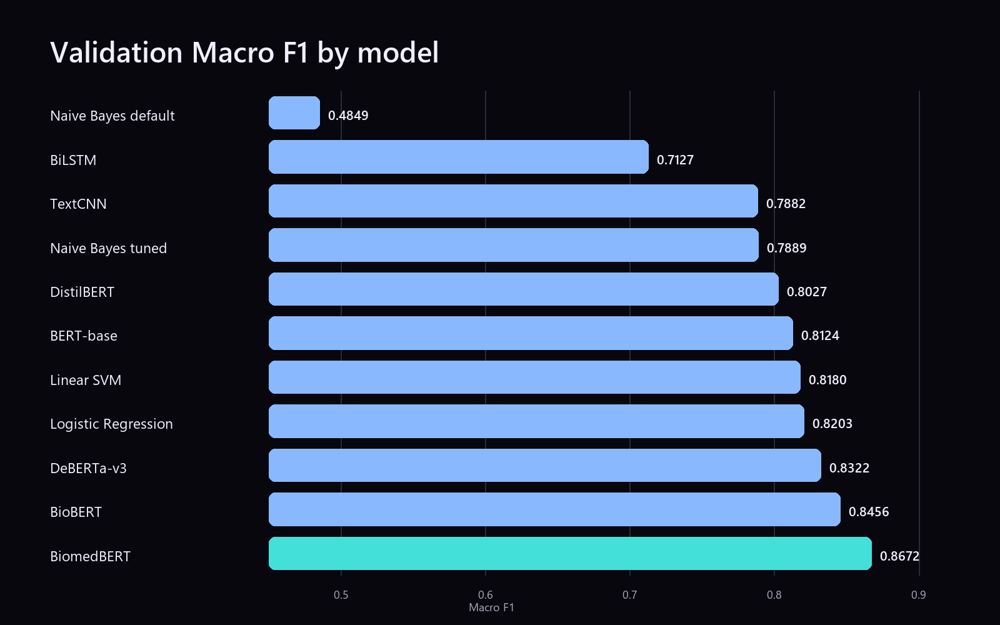
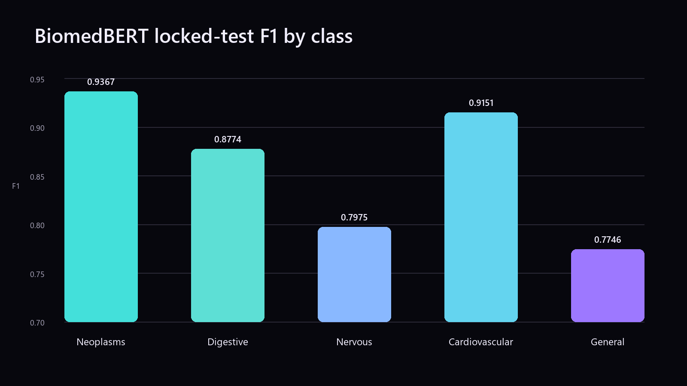

# Team Ultron: Medical Abstract Disease Classification

COE025 Natural Language Processing, Project 1, Istinye University, Fall 2026–27.

This repository contains the audited dataset, reproducible cleaning and splitting pipeline, benchmark records, Colab notebook, figures, reports, presentation, and contribution notes for a five-class medical abstract classifier.

## Final result

BiomedBERT was selected using validation Macro F1 and evaluated once on the locked test set.

| Result | Value |
| --- | ---: |
| BiomedBERT validation Macro F1 | **0.8672** |
| BiomedBERT locked test Macro F1 | **0.8603** |
| Hierarchical validation Macro F1 | **0.8599** |
| Expected Calibration Error | **0.1041** |
| Inference throughput on a Colab T4 | **35.62 abstracts/s** |

The flat BiomedBERT classifier remained the final model because the two-stage hierarchical alternative scored lower. See [BENCHMARK.md](BENCHMARK.md) for the evaluation protocol and complete comparison.

## Task

Given a medical research abstract, predict exactly one category:

1. Neoplasms
2. Digestive system diseases
3. Nervous system diseases
4. Cardiovascular diseases
5. General pathological conditions

Macro F1 is the primary metric because the classes are imbalanced and each class should contribute equally to model selection.

## Dataset

The source is the [Medical Abstracts Text Classification Corpus](https://github.com/sebischair/Medical-Abstracts-TC-Corpus) by Schopf, Braun, and Matthes (2023), DOI [10.1145/3582768.3582795](https://doi.org/10.1145/3582768.3582795).

The original corpus contains 14,438 rows. The audit found:

- 2,929 exact-text groups with conflicting labels, covering 6,140 rows
- 988 abstract texts shared by the original train and test files
- no missing labels or abstracts

Every conflicting-label group was removed. The remaining 8,298 unique, single-label abstracts were split with deterministic stratification and seed 42.

| Split | Rows | Share |
| --- | ---: | ---: |
| Train | 5,808 | 69.99% |
| Validation | 1,245 | 15.00% |
| Test | 1,245 | 15.00% |

There is zero exact-text overlap between the final splits. Raw text is preserved so each model can apply its own tokenizer or feature pipeline.

## Benchmark

Validation results are ranked by Macro F1. Test results are shown only where a locked-test evaluation artifact was available.

| Model | Group | Validation accuracy | Validation Macro F1 | Locked test Macro F1 |
| --- | --- | ---: | ---: | ---: |
| **BiomedBERT** | New method | 0.8683 | **0.8672** | **0.8603** |
| BioBERT | New method | 0.8490 | 0.8456 | — |
| DeBERTa-v3 | New method | 0.8313 | 0.8322 | — |
| Logistic Regression | Baseline | 0.8217 | 0.8203 | 0.7759 |
| Linear SVM | Baseline | 0.8241 | 0.8180 | — |
| BERT-base | Baseline | — | 0.8124 | — |
| DistilBERT | Baseline | 0.8048 | 0.8027 | 0.7818 |
| Naive Bayes, tuned | Baseline | 0.7920 | 0.7889 | 0.7542 |
| TextCNN | Baseline | — | 0.7882 | — |
| BiLSTM | Baseline | 0.7333 | 0.7127 | — |
| Naive Bayes, default | Baseline | 0.6755 | 0.4849 | 0.4996 |

The full machine-readable tables are in [`results/`](results/).



## Final model details

The selected checkpoint is `microsoft/BiomedNLP-BiomedBERT-base-uncased-abstract-fulltext` with 109,486,085 parameters.

| Locked test metric | Value |
| --- | ---: |
| Accuracy | 0.8635 |
| Macro precision | 0.8563 |
| Macro recall | 0.8651 |
| Macro F1 | **0.8603** |
| Weighted F1 | 0.8623 |

General pathological conditions remained the hardest class, with test F1 0.7746. The model was overconfident on validation: accuracy was 0.8683, mean confidence was 0.9706, and ECE was 0.1041.



## Reproduce the data pipeline

Python 3.10 or newer is recommended.

```bash
python -m venv .venv
# Windows: .venv\Scripts\activate
# macOS/Linux: source .venv/bin/activate
pip install -r requirements.txt

python src/01_dataset_audit.py
python src/02_clean_dataset.py
python src/03_create_splits.py
python src/verify_artifacts.py
```

The three data scripts operate from the repository root, preserve `data/raw/`, and recreate the processed datasets and preparation reports.

## Reproduce the classical baselines and figures

```bash
python src/run_classical.py --data-dir data/processed --output results/classical_reproduction.csv
python src/make_figures.py
```

Transformer training is recorded in [`notebooks/04_baseline_benchmark.ipynb`](notebooks/04_baseline_benchmark.ipynb). Use a GPU runtime, upload or mount the files in `data/processed/`, and run the cells in order. GPU training can vary slightly even with fixed seeds, so the final reported values remain the canonical experiment record.

## Repository layout

```text
.
├── README.md
├── BENCHMARK.md
├── LICENSE
├── requirements.txt
├── data/
│   ├── raw/                 original corpus files
│   └── processed/           clean master and frozen splits
├── src/                     audit, cleaning, splitting, baselines, verification
├── notebooks/               cleaned Colab notebook snapshot
├── results/                 canonical CSV result tables
├── figures/                 generated benchmark figures
├── reports/                 audit, cleaning, split, and final-model reports
├── presentation/            final deck and individual slide images
└── contributions/           team contribution records
```

## Notebook provenance

The notebook snapshot came from the shared Colab document:

<https://colab.research.google.com/drive/16WUP3B2rwgcXii_abqoziN7KphqATjCP?usp=sharing>

Execution outputs were removed to keep the repository compact and avoid stale embedded tables. The source cells were retained, one obsolete display-only cell was removed, and the benchmark constants were aligned with the final canonical metrics listed above. Details are in [`notebooks/README.md`](notebooks/README.md).

## Team

- Azaa Almousli: dataset analysis, preprocessing, TextCNN, and DeBERTa-v3 experiments
- Saleh Almasaadi: dataset cleaning and deterministic train/validation/test splits
- Tasnim Alibraheem: model research, metric selection, and BiomedBERT fine-tuning
- Ranim Alyasein: feature engineering, model comparison, benchmark table, and presentation
- Muhammet Çelik: DistilBERT, classical tuning, final evaluation, error analysis, calibration, and documentation

Expanded records are in [`contributions/`](contributions/).

## Licensing and citation

Project code is released under the MIT License. The source dataset and derived clean splits retain the upstream CC BY-SA 3.0 terms; see [`data/raw/UPSTREAM_LICENSE.txt`](data/raw/UPSTREAM_LICENSE.txt) and the licensing notice in [`LICENSE`](LICENSE).

```bibtex
@inproceedings{schopf2023evaluating,
  author    = {Schopf, Tim and Braun, Daniel and Matthes, Florian},
  title     = {Evaluating Unsupervised Text Classification: Zero-Shot and Similarity-Based Approaches},
  booktitle = {Proceedings of the 2022 6th International Conference on Natural Language Processing and Information Retrieval},
  year      = {2023},
  pages     = {6--15},
  doi       = {10.1145/3582768.3582795}
}
```
